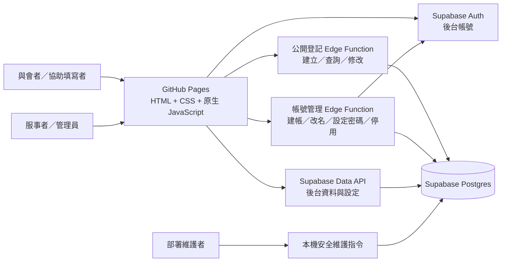

# 2027 國際華語相調特會｜38 會所登記系統架構規劃

> 2026-11-09 價格修訂：所有身分空白價格均為未設定，不沿用一般價；0 才表示免費。費用合計／補貼只加總已設定的價格，並註明未計入的身分。請追加套用 `202611090003_independent_identity_prices.sql`，解除一般價依賴；本段取代舊版價格回退規則。

> 狀態：上線 MVP 架構基準。依據 [接待與登記表規劃](2027新春華語相調特會_接待與登記表規劃.md) 與 2026-11-02～2026-11-04 的需求討論整理。最新開發順序、部署日與驗收關卡見 [TODO](TODO.md)；核心流程或資料安全驗收未過則延後公開。
>
> 本系統記錄 **38 會所的本地調查與彙整進度**。填寫本系統不等於完成大會正式報名；大會另有匯入系統。

> 2026-11-04 修訂：完整服事者／管理員後台改列本次上線範圍；公開與後台均移除取消／恢復。Turnstile 改於主要功能上線後擴充，現階段使用既有防濫用控制並保留後續整合空間。下文尚未更新的舊描述，以 [TODO](TODO.md) 為準。

> 2026-11-05 開家接待：每筆登記另外回答開家接待意願，與活動分開設定；決策見 [需求討論與決策紀錄](需求討論與決策紀錄.md)。

> 2026-11-04 查詢方式改版：填寫者改用「姓名＋區」查詢，不再使用查詢碼；有效登記的姓名＋區不可重複，服事者以「作廢」取代疑似重複流程。決策見 [需求討論與決策紀錄](需求討論與決策紀錄.md)。

> 2026-11-09 修訂：用餐身分改由 `registration_identities` 管理，`registrations.meal_identity` 外鍵引用穩定代碼；各活動身分價格放在 `activity_identity_prices`。公開與後台共用 `Meals` 計算最新價格，SQL 驗證身分可用性，管理操作保留審計紀錄。完整規則與部署順序見 [用餐身分管理](用餐身分管理.md)。

## 1. 上線範圍與階段

### 1.1 上線 MVP

- 一人一筆登記。填寫者可以是本人，也可以是任何協助填寫的弟兄姊妹；系統不區分代填者。
- 與會者填姓名，會所固定顯示「38 會所」，區從林森、忠孝、杭州、其他選擇。第一版不收電話、與會者 email。
- 每人回答所有公開開放的聚會、用餐或其他活動，可以全部不參加。可在截止前輸入相同的姓名與區查看內容；查詢結果先以純文字供確認，按「修改登記內容」後才顯示選項與儲存／取消操作。姓名與區只能由服事者更正。公開介面不提供作廢或恢復操作。
- 有效登記的姓名＋區不可重複。姓名寫法不同而查不到時，由服事者在後台以姓名或流水號搜尋協助。
- 活動、區、時間表與系統設定由管理員在後台維護，頁面仍從資料庫動態讀取，不寫死於 HTML。
- 用餐費用分一般價與各用餐身分的選填價格，只用來計算**目前預估金額**；勾選任一用餐活動須回答用餐身分（見 3.6）。活動可記錄只在後台使用的實際成本以估算補貼。不處理收款、退款或結算。
- 開家接待調查開放時，每筆登記另外回答開家接待意願（見 3.5）。
- 上線 MVP 包含服事者／管理員後台、統計與通用 CSV；不處理接待家庭與外地聖徒的分配與追蹤，也不連接大會系統 API。

### 1.2 後台與上線後擴充

- 服事者管理名單、協助修改、作廢填錯或不參加的登記、更新大會匯入進度、查看統計並匯出 CSV。
- 管理員管理服事者帳號、活動、詳細時間表與本地調查截止時間。區固定，後台不提供區選項管理。
- 稽核紀錄照常寫入，不在後台顯示。Cloudflare Turnstile 於主要功能上線後新增，屆時仍須在服務端驗證。
- 取得大會系統範本後，再製作可驗證的專用 CSV；通用 CSV 不宣稱可直接匯入。

後台已加入本次必要功能範圍；其他新功能只接受必要的 bug、安全與文字內容修正。公開與後台必要驗收通過後才開放；最新時程見 [TODO](TODO.md)。

來源需求檔目前在「主日午餐」總覽表中途結束；本文件以已明確討論的決策為準，未把缺失段落推定為功能。

## 2. 系統組成

沿用靜態頁面方式：GitHub Pages 提供 HTML、CSS、原生 JavaScript；瀏覽器使用 Supabase 用戶端連接本案專用的 Supabase Cloud。開發／自動測試與正式環境使用兩個獨立專案，不共用其他專案的資料表、帳號或 RLS 政策。

| 層 | 責任 |
| --- | --- |
| 靜態頁面 | 顯示活動資訊、填表、姓名與區查詢、名單與統計；不保存管理密鑰。 |
| Supabase Auth | 服事者與管理員的登入及密碼雜湊。填表者不建立 Auth 帳號。 |
| Edge Functions | 執行匿名登記、姓名與區查詢、依來源限速與基本濫用防護；另由管理員專用函式執行 Auth 帳號管理。未來加入 Turnstile 時在服務端呼叫 Siteverify。 |
| Postgres + RLS | 保存資料、限制各角色可讀寫的表與資料列；權限判斷不依賴頁面是否顯示按鈕。 |

瀏覽器 runtime 不使用 build step。Node.js 與 npm 只在開發階段執行本機靜態伺服器與 Playwright；Supabase CLI 可用時也用於部署，部署環境無法使用時改由 Dashboard 依版控 SQL 與 Edge Function 原始碼部署。使用仍受支援且已修補的 LTS，套件鎖定精確版本並提交 `package-lock.json`。正式 GitHub Pages 不執行 Node.js server。

`SUPABASE_URL` 與 publishable／anon key 可放在部署後的 `config.js`，因為它們會送到瀏覽器；Supabase secret／service role key 只能放在 Edge Function 的伺服端環境。公開操作與後台權限由服務端和 RLS 驗證。

## 3. 頁面與使用流程

| 頁面 | 主要內容 |
| --- | --- |
| 公開登記頁 | 特會資訊、注意事項、詳細時間表、目前開放的活動、姓名與區、各活動參加／不參加選擇；以 RWD 支援桌機、筆電、平板與手機。 |
| 完成頁 | 顯示這次送出的姓名、區與各活動選擇，並提示日後以相同姓名與區查詢；流水號保留供內部核對。 |
| 查詢／修改頁 | 與公開登記頁同一區塊，以 tab 切換。輸入姓名與區後回傳該筆有效登記，先以中性純文字顯示參加／不參加／未回覆；按「修改登記內容」後才顯示 radio。查詢與修改畫面不顯示地圖連結，地圖只在報名頁提供。截止後可查看，不能自行變更。流水號不能取得資料。 |
| 後台登入頁 | 服事者輸入帳號與密碼。沒有公開申請帳號頁。 |
| 後台名單與統計 | 依姓名、區、流水號、活動、匯入狀態搜尋；顯示有效／作廢狀態、未回覆、目前預估金額；可匯出 CSV。登記名單每頁 10 筆，可依姓名或流水號、區與「兒童」（只列兒童）一起篩選（在 `staff` Edge Function 執行），「清除條件」一次清空條件；「更新時間」與「操作」之間有「親子」欄（見 3.7）；「查看／處理」先以查看模式鎖住欄位，按「修改登記資料」才能修改。 |
| 後台設定 | 管理員維護活動、詳細時間表、截止時間、開家與接機接待設定及服事者帳號。區固定，後台不提供區選項管理。 |
| 後台版面 | 上方導覽列一次只顯示一個功能畫面，登入後預設「登記名單」，導覽列標示目前功能；切換時保留未儲存的輸入。重新整理停在原畫面，登出後從登記名單開始；網址不記錄畫面。 |

### 3.1 公開登記

1. 載入特會資訊、詳細時間表、有效區選項與**目前開放**的活動。
2. 填姓名與區；每個當時開放的活動都明確選「參加」或「不參加」，可以全部不參加。未開放的活動不要求回答。
3. Edge Function 驗證輸入、截止時間、honeypot、最短合理填寫時間及 `create_request_id`，在同一筆資料庫交易建立登記與各活動選擇。
4. 同區已有相同姓名的有效登記時擋下送出，提示改用查詢。建立成功後公開 API 只回傳成功狀態，完成頁顯示這次送出的內容；流水號留在內部資料。

管理員日後新增活動時，舊登記對新活動為「未回覆」，不會自動當作「不參加」。首次填寫的新登記仍須回答當下所有開放活動。舊登記只查看時可保留未回覆；再次儲存修改時，必須回答當下所有公開活動。

### 3.2 查詢、確認與修改

- 填寫者輸入姓名與區查詢。姓名照填寫內容保存與顯示；比對時先做 Unicode NFKC 正規化，再轉小寫並移除所有空白與零寬字元，因此全形／半形、大小寫與空白差異不影響查詢。英文姓名順序、中英文混用或簡繁體不同時視為不同姓名。
- 知道姓名與區的人都能查看該筆登記並修改活動選擇，這是改版時接受的取捨；活動選擇的敏感度低，修改會寫入 audit，服事者可更正。開家接待回答同樣可被知道姓名與區的人查看與修改，因此只收選項、不收文字；地址等聯絡資料由服事者另行取得，不存入本系統。姓名與區是查詢依據，只能由服事者更正，避免登記被改名後本人查不到。
- 流水號是內部辨識紀錄用的編號，不能用來取得資料。
- 公開新增、查詢與修改依來源限速，成功與失敗都計入，另有全站上限；額度到期自動恢復。查無資料時回傳一致訊息。偵測條件不公開；門檻與調整規則見[需求討論與決策紀錄](需求討論與決策紀錄.md)「2026-11-07 上線尖峰限流」一節。
- 管理員可在後台網站設定關閉「開放公開查詢與修改」（`is_lookup_open`），緊急時立即停止公開查詢與修改；關閉登記只停止新增與修改，不會停止查詢。
- 截止前查詢成功後先進入確認狀態，以純文字顯示參加／不參加／未回覆；按「修改登記內容」才進入修改狀態並顯示 radio、「儲存修改」與「取消修改」。沒有實際變更時不能儲存；儲存成功後回到確認狀態。取消、切換 tab、重新查詢或離開頁面時，只有存在未儲存變更才提醒。公開介面不提供作廢或恢復操作；截止後僅可查看。

### 3.3 大會匯入進度

這是 38 會所的**內部作業狀態**，並非大會報名成功狀態：

| 狀態 | 定義 |
| --- | --- |
| 待匯入 | 新建立且尚未由服事者確認匯入大會系統。 |
| 已匯入 | 服事者確認這筆資料已在大會系統處理，並手動標記。單純按下 CSV 匯出不會改成此狀態。 |
| 需重新匯入 | 已匯入後，大會所需資料異動；具體範圍依下方 2026-11-11 規格。 |

2026-11-11 新規格：活動以 `affects_conference_import` 決定是否影響大會匯入，初始只勾選 2/20、2/21 特會。只有勾選活動的回答異動會觸發，未回答補不參加也算；其名稱、日期時間、是否含時分、公開狀態異動，只影響回答參加的有效且已匯入登記。勾選與取消勾選亦同。新增活動本身不觸發；首次 migration 初始化設定不改既有匯入狀態。

姓名、區、任何身分別、開家回答／對象／人數、接機回答／人數、作廢仍觸發；只改家長姓名、價格、成本、報名對象或其他活動設定不觸發。自動轉換只有已匯入 → 需重新匯入，其他狀態維持；儲存後改回原值不會自動恢復已匯入。手動標記規則保持。完整 Q1～Q8 見需求討論與決策紀錄同名章節。

### 3.3.1 接待身分設定（2026-11-11 新規格）

開家與接機各自依 `site_settings` 的身分清單及總開關控制公開填寫；初始僅一般，兒童亦可設定，後台可替任何身分填答。回答以 `answer_valid` 區分有效填答與保留歷史，取代下列舊節「非一般一律存否」規則。取消設定不清除資料。公開頁與後台把身分改成某題不可填的身分並儲存時，該題存成有效的否；公開頁同一次編輯未儲存的切出再切回須重答。查詢可看有效答案但不可填者唯讀；無有效答案不計入否與容量，不適用者分開顯示。活動資格依兩題的身分清單分別豁免。完整決策、回填與部署見 [接待身分設定](接待身分設定.md)。

### 3.4 同名同區與作廢

有效登記的姓名＋區不可重複，公開登記、服事者協助登記及更正姓名或區都適用。登記填錯、惡作劇或不參加時，服事者將該筆「作廢」並必須填寫原因；作廢紀錄保留供後台查核，不計入有效人數、預估費用與 CSV，也不佔用姓名與區。不提供永久刪除、頁面上恢復或公開取消。

### 3.5 開家接待

- 每筆登記回答一次。同一家只需一人選「是」，其他家人選「家人已登記開家接待」；系統無法判斷是否為同一家，重複時由服事者人工比對。
- 公開報名頁與查詢頁的接待區塊放在「活動選擇」之前，以淺綠底色與活動清單區隔。後台登記資料與協助登記把接待放在左欄、活動在右欄，手機上同樣接待在前。完成頁維持原順序。
- 公開頁問「是否可以開家接待？」，選項為是／否／家人已登記開家接待（存成 `hosting`／`not_hosting`／`family_registered`）。選「是」時必填「可以接待幾位？」（1～10 人，一律算人數）與「接待對象」（夫婦／弟兄／姊妹／不拘），兩者為預設「請選擇」的下拉選單。不選晚上，代表整個接待期間。接機接待是另一項獨立調查，見 3.5.1。
- 管理員在「開家與接機接待」設定區塊分別設定開家開關（`is_hosting_open`）與說明文字（`hosting_description`），以及接機開關與說明文字（見 3.5.1）；截止時間與登記共用。開關只控制公開頁。開家開放時公開新增與修改都必須回答；關閉時公開登記頁不顯示開家題，查詢頁唯讀顯示既有回答，公開 API 拒絕新的或變更的開家回答。請求沒有帶開家回答時沿用已存的回答，只有從未回答的登記在開放時必須回答。頁面載入後開關才改變時，伺服器回傳固定錯誤代碼，頁面據此顯示或移除開家欄位並保留其他尚未儲存的內容。
- 服事者在後台可隨時填寫與修改接待，不受開關限制。協助登記在開關開啟時必答、關閉時可留空，與公開登記一致；已回答的接待不能改回未回覆，原本未回覆的可以維持。
- 已匯入的登記，接待任一欄位實際變更即改為「需重新匯入」，並寫入 audit。

### 3.5.1 接機接待

- 接機與開家各有開關及說明。公開報名與查詢頁同用淺綠區塊；報名頁依開關顯示題目，查詢頁關閉時仍可唯讀查看既有答案。兩題都顯示時各有一個「開家接待」「接機接待」標題，以淡分隔線和間距區分。接機題與開家題使用相同文字樣式。後台導覽列及共用設定區塊稱為「開家與接機接待」，採緊湊版面。
- 「2/19 或之前可以配搭接機幾位？」先選是／否；選是才選 1～6 位，選否為 0 位。人數預設「請選擇」，未回答與不能接機可分別統計。開放時公開新增必答；關閉時公開新增不顯示、修改沿用已存答案。沒有開家的人也可接機；服事者可在後台填寫與修改。提示「同一台車只需一人填寫，避免重複計算」，計算方式不另去重。
- `registration_pickup` 獨立保存答案：沒有資料列＝未回答，`status = 'yes'` 時 `count` 為 1～6，`status = 'no'` 時 `count = 0`。舊 `registration_hosting.pickup_count` 的 1～6 轉成「是」；舊 0 是預設值，轉成未回答。只在實際變更時寫入 audit，已匯入的登記改為「需重新匯入」。舊欄位為部署相容而暫留，待兩個 Edge Function 更新後移除。

### 3.6 用餐身分與報名對象

> 2026-11-10 本機已實作、待部署：四處表單改上方統一「身分別」，新登記無論是否用餐都必填，修改保留原值，移除活動區用餐身分題。「姓名／區／身分別」標題在上、欄位在下，桌機並排、手機不足時換行。選項沿用後台管理及既有停用／非公開值保留規則，資料欄位暫沿用 `meal_identity`。本段取代下方僅用餐時顯示身分的規則；詳見 [用餐身分管理](用餐身分管理.md) 最新修訂。

- 用餐身分由管理員在後台「身分別」維護（`registration_identities`：穩定代碼、名稱、啟用、開放報名者選擇）。一般與兒童為保留身分，只能改名稱；兒童一律由「兒童」勾選帶入，成人不能選。本機已實作，待部署：兒童身分依兒童類型分成學齡前與國小兩個（見 3.7 兒童類型）。已使用的身分只能停用，停用後既有登記保留，其他登記不能新選；未開放報名者選擇的身分只能由服事者在後台指定。
- 活動可設定一般價（`fee_amount`）與各身分價格（`activity_identity_prices`），每種身分獨立設定：留空代表未設定，不沿用一般價，0 代表免費。登記勾選任一公開的用餐活動（`category = 'meal'`）時，須回答用餐身分（`meal_identity`）；沒有勾選時畫面不顯示，已存的身分保留。請求沒有帶身分時沿用已存的身分，從未回答則存一般。公開頁與後台規則相同，由資料庫 `registration_meal_identity` 強制。規則細節見 [用餐身分管理](用餐身分管理.md)。
- 活動報名對象（`audience`）目前單選：`all`、`hosting`、`pickup` 或 `activity:<活動 ID>`，並保留日後擴充多選的彈性。後台活動選項取自實際活動資料，含標示「未公開」的活動；不能選自己或形成循環。`hosting` 須開家回答「是」或「家人已登記開家接待」；`pickup` 須獨立接機回答「是」，調查關閉時也採已存答案；`activity:<ID>` 須參加該活動，且該活動目前已公開。限定對象提示選填，留空不顯示。公開頁與後台都將不符者的選項停用並記為不參加；取消前置活動時依賴活動也退回不參加，同畫面重新勾選時恢復原本的「參加」。資料庫 `registration_audience_valid` 在每次儲存時拒絕不符者的「參加」。限定前已報名的不符者保留原資料，直到下次儲存：公開頁打開修改畫面本身不算變更，要連同其他變更一起儲存；後台儲存前先確認「這筆登記有 N 項限定活動不符報名對象，儲存後會改為不參加」。
- 身分價格須搭配一般價（後台儲存時檢查；學生價另有資料表約束 `activities_student_fee_needs_fee`）。`student_fee_amount` 由後台隨學生身分價格一併送出，只供舊版讀取。查詢頁、統計與 CSV 只在參加用餐時顯示身分。
- 預估費用依每人的身分取該身分的最新價格，不保存報名當時的價格。該身分沒有價格或尚未回答身分時不計入合計，並註明未計入的身分（規則見[用餐身分管理](用餐身分管理.md)「空白價格與合計」）。實際每人成本（`cost_amount`）只用於後台的預估成本與預估補貼；統計摘要只加總已設定成本的活動，並列出有費用卻未設定成本的活動名稱；全部未設定時顯示「—」。後台登記資料中未回覆的限定活動，在不符資格時維持未回覆，不自動改為不參加。

### 3.7 兒童報名

> 2026-11-10 本機已實作、待部署：統一「身分別」取代獨立兒童下拉，連動既有兒童類型及家長／接待規則。名單搜尋列改「姓名／區／身分別」，篩選一般、學生、全部兒童、各兒童類型、自訂及有既有登記的停用身分。姓名旁與詳情標題新增學生淡紫標籤，一般不加標籤，兒童沿用粉紅／粉藍。各活動與各區兒童統計改總數在上、非零類型標籤在下；費用與補貼未計入說明另行顯示淺灰底，CSV 保持可讀分隔。本段取代下方有衝突的前版介面描述；完整規則見 [需求討論與決策紀錄](需求討論與決策紀錄.md)「2026-11-10 統一身分別與統計排版」。

- 公開登記、查詢修改、協助登記與後台單筆修改都有「兒童」勾選框，位在區右邊；勾選後表單最下方出現必填的「家長姓名」（去掉前後空白後 1～20 字）。查詢修改頁的姓名、區與兒童排成一列，姓名與區唯讀；按「修改登記內容」後才能改兒童與家長姓名。
- 兒童不回答開家接待與接機接待，兩題不顯示，一律存「否」，不管問卷是否開放；也不受 `hosting`、`pickup` 兩種報名對象限制，`activity:<ID>` 照常套用。由資料庫在儲存時強制：`*_with_pickup` RPC 以交易內設定標記兒童的儲存，`registration_audience_valid` 據此放行。
- 請求沒帶兒童欄位時，新登記不是兒童，修改則沿用已存值，所以舊版頁面不會清掉兒童資料。只改兒童或家長姓名不改匯入狀態；連帶改成「否」的接待回答依 3.3 需重新匯入。
- 後台登記名單「親子」欄：兒童顯示「家長：家長姓名」；不是兒童的有效登記，若同區有有效兒童的家長姓名比對鍵（`parent_name_key`，規則同 `name_key`）等於自己的 `name_key`，顯示「兒童：」加這些兒童的姓名（以「、」分隔）。對應關係不儲存，由 `staff` Edge Function 在載入每頁 10 筆時以 `registration_children` 查詢（索引 `registrations_active_child_parent`），有對到兒童時再一次查出兒童姓名。家長的「查看／處理」在姓名與區下方列出這些兒童（流水號與姓名）；查看時點名字會把名單改成搜尋該流水號並打開兒童的登記，修改中只顯示文字。表格上方以提示文字說明這個呈現方式。兒童的用餐身分一律為兒童（見 3.6）。
- 統計「各區」小表有「其中兒童」欄，個人明細 CSV 有「兒童」「家長姓名」兩欄；費用與用餐身分不因兒童而不同。決策見[需求討論與決策紀錄](需求討論與決策紀錄.md)「2026-11-09 兒童報名」一節。
- 兒童類型（2026-11-09 決策，本機已實作，待部署）：兒童分學齡前與國小，存在 `registrations.child_type`（`preschool`／`elementary`，check `is_child = (child_type is not null)`，既有兒童回填國小）。四處表單的兒童勾選框改成下拉「請選擇／學齡前（6 歲以下）／國小」，選學齡前顯示身高年齡提示；後台修改按「修改登記資料」後才能改。已匯入的登記改類型時改為需重新匯入。用餐身分依類型帶入 `preschool`（兒童（學齡前））或 `child`（兒童（國小）），兩者都是保留身分。後台名單篩選改下拉「全部／全部兒童／學齡前／國小」，姓名旁加類型標籤；統計寫「其中兒童 N（學齡前 a、國小 b）」；CSV 兒童欄填「學齡前」或「國小」。本段取代本節與 3.6 的兒童勾選寫法。決策見[需求討論與決策紀錄](需求討論與決策紀錄.md)「2026-11-09 兒童類型：學齡前與國小」一節。

## 4. 資料模型草案

資料表與欄位名稱是實作建議；開發時可依 SQL migration 調整命名，但須保留此處的資料語意與權限。

| 資料表 | 主要欄位 | 用途與約束 |
| --- | --- | --- |
| `districts` | `id`, `name`, `sort_order` | 初始三區：林森、忠孝、杭州；2026-11-05 新增「其他」。會所的區固定，管理員可新增、改名，不提供停用或刪除。 |
| `site_settings` | `id`, `event_name`, `venue`, `address`, `event_note`, `registration_deadline_at`, `is_registration_open`, `is_lookup_open`, `is_hosting_open`, `hosting_description`, `is_pickup_open`, `pickup_description`, `updated_at` | 單筆系統設定。`event_note` 為公開頁地址下方的備註（例如交通資訊），500 字內，`https://` 網址顯示為連結。開家與接機各有預設關閉的開關及 2000 字內的公開說明；只控制公開頁，各自可單獨開放。`is_registration_open` 必須為 `true` 才能登記；截止時間為空代表無期限，有設定時才檢查是否截止。時間使用帶時區時間戳，畫面以台灣時間顯示。 |
| `program_items` | `id`, `event_date`, `start_time`, `end_time`, `title`, `note`, `sort_order`, `is_visible` | 詳細聚會時間表。可記錄第一至第五堂、展覽、擘餅等；不直接產生報名選擇。未確定時間可留空並顯示待定說明。 |
| `activities` | `id`, `category`, `title`, `starts_at`, `starts_at_has_time`, `ends_at`, `ends_at_has_time`, `venue`, `address`, `map_url`, `description`, `fee_amount`, `student_fee_amount`, `cost_amount`, `audience`, `audience_note`, `is_published`, `sort_order`, `created_at`, `updated_at` | 可選擇的聚會、用餐、其他活動。日期可單獨設定，時間選填；`starts_at_has_time` 與 `ends_at_has_time` 保留管理員是否輸入時間的意圖。管理員可任意新增；費用以 NT$ 整數記錄，`fee_amount` 為一般價、`student_fee_amount` 為學生價（舊版相容，現行以 `activity_identity_prices` 為準），`NULL` 代表未設定，`0` 代表免費。`cost_amount` 為實際每人成本，只供後台統計；公開角色以逐欄授權讀取已公開活動，不含此欄，日後新增的欄位也須明確授權才公開。`audience` 為 `all`／`hosting`／`pickup`／`activity:<ID>`（見 3.6），`audience_note` 為限定對象提示（200 字內，空白時不顯示）。已有選擇紀錄的活動只能停用，不能刪除。 |
| `registrations` | `id`, `serial_no`, `create_request_id`, `full_name`, `name_key`, `district_id`, `meal_identity`, `is_child`, `parent_name`, `parent_name_key`, `record_status`, `import_status`, `created_at`, `updated_at`, `imported_at`, `imported_by` | 一人一筆。`meal_identity` 以外鍵引用 `registration_identities.code`，每筆登記都有值，兒童一律為 `child`（見 3.6）。`is_child` 標記兒童，`parent_name` 只在兒童時必填（1～20 字），`parent_name_key` 由資料庫依姓名比對規則自動產生（見 3.7）。本機已實作，待部署：新增 `child_type` 區分學齡前與國小（見 3.7 兒童類型）。`id` 是內部 UUID；`serial_no` 由資料庫序列產生，畫面格式為 `活動流水號起始值`，超過四位時自然延長，失敗的建立可能留下跳號。`create_request_id` 用來防止同一送出請求因重試而建立兩筆。`name_key` 由資料庫依姓名比對規則自動產生；`record_status = 'active'` 的登記以「區＋`name_key`」設唯一索引，作廢為 `void`。 |
| `registration_identities` | `code`, `name`, `is_active`, `public_selectable`, `sort_order` | 用餐身分。`code` 穩定不變，名稱可改且不重複；`general`、`child` 保留，必須啟用且開放選擇。被登記使用的身分不能刪除（外鍵）。本機已實作，待部署：新增保留身分 `preschool`（見 3.7 兒童類型）。 |
| `activity_identity_prices` | `activity_id`, `identity_code`, `fee_amount` | 各活動的身分價格，複合主鍵；不存一般價（即 `activities.fee_amount`），沒有資料列代表未設定，不沿用一般價。 |
| `registration_choices` | `registration_id`, `activity_id`, `attending`, `updated_at` | 複合主鍵避免同人對同一活動有多筆選擇。`true`＝參加，`false`＝不參加，**沒有資料列**＝未回覆。 |
| `registration_hosting` | `registration_id`, `status`, `guest_type`, `guest_count`, `pickup_count`（舊欄位）, `updated_at` | 每筆登記最多一列開家接待回答；**沒有資料列**＝未回覆。`status` 為 `hosting`／`not_hosting`／`family_registered`；只有 `hosting` 帶接待對象（`couple`／`brother`／`sister`／`any`）與人數（1～10）。`pickup_count` 僅為舊函式相容暫留，不再作為接機答案；`family_count`、`note` 也為已停用欄位，待相容期後移除。只由 Edge Function 經受控 RPC 讀寫，公開角色沒有權限。 |
| `registration_pickup` | `registration_id`, `status`, `count`, `updated_at` | 每筆登記最多一列獨立接機答案；**沒有資料列**＝未回覆。`yes` 帶 1～6 位，`no` 對應 0 位；與開家回答無依存關係。 |
| `staff_profiles` | `auth_user_id`, `username`, `display_name`, `district_id`, `role`, `is_active`, `must_change_password`, `created_at` | 後台帳號；角色只允許 `admin`／`staff`。帳號名稱不分大小寫且唯一。停用帳號後，資料庫查詢立即失去授權。 |
| `audit_events` | `id`, `actor_type`, `actor_user_id`, `action`, `target_type`, `target_id`, `before_data`, `after_data`, `created_at` | Append-only 稽核紀錄。保存公開建立、修改及後台異動；不得保存密碼、原始 IP 或防機器人憑證。照常寫入，不在後台顯示；瀏覽器角色不得讀取、新增、修改或刪除。 |

可由查詢計算的參加人數、未回覆人數與預估金額不另存一份。統計預設只計入有效登記與目前公開的活動；停用活動的舊選擇仍可在後台歷史紀錄查看。管理員停用活動前，畫面應提示受影響的登記人數，並讓服事者檢查只參加該活動的人。

### 4.1 初始活動資料

初始資料以 migration 建立；2026-11-05 弟兄提供的用餐價格與報名對象，部署後由管理員在後台設定。實際成本只在後台設定，不寫入本文件。

| 類型 | 活動 | 負擔費用 | 備註 |
| --- | --- | ---: | --- |
| 聚會 | 02/20 華語特會第一天 | 未設定 |  |
| 聚會 | 02/21 華語特會第二天，含擘餅 | 未設定 |  |
| 聚會 | 02/21 青年大會 | 未設定 | 時間與地點尚待確認 |
| 用餐 | 02/20 週六午餐 | 一般 NT$400、學生 NT$200／人 | 報名對象先設為有開家接待的聖徒，之後可能開放所有人 |
| 用餐 | 02/20 週六晚餐 | 一般 NT$500、學生 NT$300／人 | 所有聖徒可報名 |
| 用餐 | 02/21 主日午餐 | 一般 NT$500、學生 NT$300／人 | 所有聖徒可報名 |
| 其他 | 02/19 週五晚間帶菜愛筵 | 未設定 | 原主日晚間愛筵已取消並改為此活動；時間等細節待確認 |

Q43 已確認：建立下列全部活動；正式環境的未確認項目保持未公開。測試環境可暫時公開用餐及愛筵供填寫測試，並明確標示暫定資訊；青年大會和週五晚間愛筵不能因已列在規劃檔就宣稱時間、地點已確定。`202611060002` 只改原愛筵活動名稱，保留 ID 與既有回答；若已有週五活動就不改名，也不自動填入時間。

## 5. 角色與權限

MVP 包含公開流程與服事者／管理員後台。下表是本次上線須驗收的權限；不得用公開 API 或把 service role key 放入瀏覽器取代。

| 操作 | 公開訪客 | 服事者 `staff` | 管理員 `admin` |
| --- | :---: | :---: | :---: |
| 看公開活動與時間表 | ✓ | ✓ | ✓ |
| 建立登記 | 截止前，經 Edge Function 服務端驗證 | ✓ | ✓ |
| 查看登記、修改活動選擇 | 憑姓名＋區；修改限截止前 | ✓ | ✓ |
| 填寫、修改開家接待 | 憑姓名＋區；限開關開啟且截止前 | ✓ | ✓ |
| 查看、修改全體登記（含姓名與區） |  | ✓ | ✓ |
| 作廢登記、標記匯入狀態、看統計、匯出 CSV |  | ✓ | ✓ |
| 管理活動、用餐身分、時間表、截止時間、開家與接機接待設定 |  |  | ✓ |
| 建立、改名、設定密碼、停用後台帳號 |  |  | ✓ |
| 更改自己的密碼（須輸入目前密碼） |  | ✓ | ✓ |

所有登入者都可查看全體名單，不依區隔離。`staff_profiles` 的角色與啟用狀態由資料庫／Edge Function 判斷。`authenticated` 身分本身**不代表**服事者權限；沒有啟用的 profile 不得讀寫名單。公開訪客不得直接讀取 `registrations`、`registration_choices`、`registration_hosting`、`staff_profiles`、`audit_events` 或限速資料表。

### 5.1 後台帳號

- 管理員在後台指定帳號名稱、顯示名稱、角色與密碼，以既有安全聯繫方式私下交付，對方不需再更改。帳號不再指定所屬區。管理員可修改顯示名稱與帳號名稱（改名後須用新名稱登入），並可替其他帳號設定新密碼；設定後對方所有登入立即失效。替其他管理員設定的密碼，對方下次登入必須改成自己的密碼。忘記密碼由管理員重新設定。
- 所有登入者都可從導覽列「更改密碼」修改自己的密碼，須輸入目前密碼；管理員也只能用這個方式修改自己的密碼。完成後所有裝置登出。
- 第一位管理員由部署者在 Supabase Dashboard／受控初始化程序建立。關閉公開 Auth signup；不提供服事者自行申請或管理員公開註冊頁。
- 帳號管理 Edge Function 驗證呼叫者的 Auth 身分、`staff_profiles.role = admin` 與啟用狀態，才呼叫 Auth 管理 API。禁止停用最後一位有效管理員。
- 登入畫面使用**帳號／密碼**。參考專案把帳號轉成 Auth 內部使用的 email 形式再登入；本案可沿用此對應概念，但須先在新的 Supabase 專案驗證內部識別格式及管理員建帳、登入、改密碼、重設流程。這個內部識別不作為可收信地址，系統第一版不寄信。
- `must_change_password` 必須在服務端權限檢查中生效。新建的管理員帳號、被其他管理員設定密碼的管理員帳號，以及改版前的舊帳號，登入後只能進入改密碼流程；成功改密碼後才開放名單權限。服事者帳號由管理員設定密碼後不需更改。

## 6. 服務端安全界線

1. 對瀏覽器可呼叫的每張表啟用 RLS，明確設定資料表 grants 與各操作的 policy；`authenticated` 身分不能單獨取得管理權限。公開可讀的資訊只限活動、時間表與有效區選項。
2. 公開登記 Edge Function 驗證輸入長度、選項是否有效、截止時間與活動開放狀態。新增須驗證 honeypot、最短合理填寫時間及 `create_request_id`；查無資料回傳一致訊息。公開新增、查詢與修改依來源限速並有全站上限；營運控制與偵測細節不公開。前端驗證只為操作便利，不是權限依據。
3. 姓名比對只在資料庫執行。不保存原始 IP；限速只短期保存以伺服端金鑰（`RATE_LIMIT_KEY`）保護的 IP 雜湊，時間窗過後自動刪除。登入密碼交由 Supabase Auth 保存，不自行儲存明文或另建密碼欄。
4. 建立登記與活動選擇、修改與匯入狀態更新，須透過資料庫交易保持一致。`create_request_id` 設唯一約束，防止同一請求因網路重試產生兩筆；若首次回應遺失而重送，系統會拒絕重複建立，填寫者可改用姓名與區查詢確認。
5. 管理員專用 Edge Function 使用的 secret key 只存伺服端。`config.js`、HTML、GitHub Actions 發布成品中不得出現密鑰。主要功能上線後再加入 Cloudflare Turnstile；屆時前端取得 token、服務端呼叫 Siteverify，並以新 migration 調整建立登記限額、重新驗收防濫用。未完成前，本次公開流程不得依賴 Turnstile 設定。
6. 針對匿名、一般已登入但未授權、停用服事者、服事者、管理員，驗證允許與拒絕的存取情境；特別測試不能用流水號讀寫資料、不能透過公開 API 修改姓名或區，以及作廢紀錄無法被公開查到。
7. 建立、修改及匯入狀態更新透過受控 RPC／Edge Function，在資料庫交易內完成並寫入 `audit_events`。Audit 只允許新增，不允許一般角色修改或刪除。

## 7. 後台統計與 CSV

- 按區、活動計算參加／不參加／未回覆人數，涵蓋全會所有效登記者與目前公開的活動；沒有活動選擇紀錄算未回覆。「各區各活動」先列一張「全會所」小卡，彙總所有區每項活動的參加／不參加／未回覆人數，之後每區一張小卡；寬螢幕每列 3 張（全會所與 4 個區為上 3 下 2），手機每列 1 張；標題顯示全會所或該區有效登記人數，卡內不加合計（同一人參加多項會重複計算）；各區小表另有「其中兒童」欄與合計列（有效登記、其中兒童、預估費用），開家接待回覆與接待對象也有合計列。作廢不計入有效人數；既有測試資料若有已取消狀態也不計入。
- 顯示以**目前活動費用**計算的預估總額，依每人的用餐身分取該身分價格，未設定價格與未回答身分者不計入，「各活動」表在金額後註明未計入的身分，摘要與「各區」只顯示金額。各活動另列其中學生、其中兒童人數、預估成本與預估補貼（未設定實際成本時顯示「—」），摘要列出總成本、總補貼，以及限定前已報名的不符對象人數。待匯入、已匯入、需重新匯入的人數待大會匯入流程確定後再做。費用調整後重新計算，不保存舊費用快照。
- 第一版 CSV 為「每人一列、每個目前公開活動一欄」，另有流水號、姓名、區、兒童、家長姓名、內部匯入狀態；活動欄輸出參加／不參加／未回覆。作廢登記不匯出。CSV 用 UTF-8 BOM 以利常見試算表開啟，並處理可能被試算表當作公式的文字欄位。
- 開家接待回覆統計只列是、否、未回覆的登記數，不列「家人已登記開家接待」的人數；合計仍為全部有效登記人數，並加註「合計含未列出的接待回答」。這些回答不併入否或未回覆，登記選項不變。接待對象仍列夫婦、弟兄、姊妹、不拘各自的登記數與人數和合計。獨立接機統計區分未回覆、不能接機與可接機，仍列可配搭接機的登記數及可載總人數，不按車輛另外去重。原本的每人一列 CSV 另含開家接待、接待對象、可接待人數、可接機人數 4 欄，以及用餐身分與預估應付餐費 2 欄；不含實際成本。登記名單不顯示接待與用餐身分欄位。
- 「統計與匯出」另提供「下載統計 CSV」，保留原有個人明細 CSV 的按鈕（2026-11-08 起名為「下載報名登記 CSV」）及固定欄位格式。統計 CSV 匯出畫面上的各活動、各區、開家接待回覆、接待對象、接機及各區各活動統計，含適用的合計、費用／成本／補貼與開家接待合計註記，不含個人明細；計算口徑與畫面一致。
- 匯出 CSV 不自動標記「已匯入」。大會系統格式尚未取得，取得範本後另做欄位對應與匯出驗證。

## 8. 部署與營運

- 分支流程為 `feat/*` → `develop` 整合 → `main` 正式環境。上線後 GitHub Pages 只由 `main` 部署，測試改用本機或獨立測試站（見[正式環境設定流程](正式環境setup.md)第 9 節）。GitHub Pages 正式站只部署 `main` 的網站成品目錄，不得把 SQL、測試、規劃文件、`node_modules` 或 secrets 放入 artifact。
- 本機靜態頁面直接連遠端開發／測試 Supabase Cloud；正式環境使用另一個 Supabase 專案。兩個專案都由同一組版控中的 migration／seed 建立；依核准的部署程序套用已版控的資料庫與函式變更，保留部署紀錄。
- GitHub Actions 產生僅含公開設定的 `config.js`。開發專案的本機設定檔不得進版控；service role key、資料庫密碼及 Edge Function secrets 不得出現在前端設定或 GitHub Pages 成品。
- 部署正式站前完成可重複執行的資料庫與 Playwright 測試；GitHub Actions 完整 CI 可延後。Playwright 自動測 Desktop Chromium、Desktop WebKit、Mobile Chrome 與 Mobile Safari 模擬。
- 開放前部署正式環境並完成封閉驗收，使用實際 iPhone、iPad 或 Mac Safari 完成 smoke test。Playwright WebKit 不取代實際 Safari 驗收。
- 正式開放前設定 `is_registration_open`、確認四個區（含「其他」）與公開活動，並完整測試建立、姓名與區查詢、確認／修改狀態切換、儲存、取消與未儲存變更提醒、查無資料、同名同區擋下、作廢後重新登記、截止規則、限速及 RLS 拒絕案例。
- 後台帳號改由管理員建立，不寄驗證信、申請通知或密碼重設信；第一版**不依賴 Mailgun／Resend，也不需要寄信網域**。
- 正式開放前依核准的資料生命週期程序處理驗收資料，完成備份、範圍核對與授權確認；不在公開文件記載資料清理操作細節。
- 特會結束、匯入與核對完成後，由管理員先匯出備份，再手動清除姓名與登記資料。**清除日期由 38 會所決定**；本文件不自行設定期限。清除前須明確預覽資料範圍並保留可還原的備份。

## 9. 上線前待確認與技術驗證

| 項目 | 目前狀態 | 對實作的影響 |
| --- | --- | --- |
| 本地調查截止日期 | 待公告 | 由管理員填入；未設定時不得誤顯示已確定日期。 |
| 青年大會時間、地點及週五晚間愛筵細節 | 待公告 | 初始活動須標示暫定或保持未公開，待管理員確認；原主日晚間愛筵已取消。 |
| 餐廳地圖連結與部分用餐時間 | 待補 | 活動欄位允許暫時留空。 |
| 大會系統匯入範本 | 未提供 | 第一版只提供通用 CSV；不能聲稱可直接匯入。 |
| 活動後資料清除日期 | 由 38 會所決定 | 確定營運保留期限後再執行手動清除。 |
| 內部帳號識別格式 | 尚未在新 Supabase 專案驗證 | 完整後台實作前測試建帳、帳號／密碼登入、改密碼與重設。若 Auth 拒絕不收信的內部識別格式，須改用經確認可用的識別方式，不能以公開註冊或關閉權限檢查繞過。 |
| Cloudflare Turnstile 啟用時間 | 主要功能上線後擴充 | 防機器人服務憑證依環境隔離並由伺服端驗證；本次先驗收現有防濫用控制。 |
| 上線功能凍結（Q42） | 已確認 | 只接受必要的 bug、安全與文字內容修正，避免完整後台阻擋 MVP。 |
| 初始活動建立策略（Q43） | 已確認 | 建立全部規劃活動，未確認項目保持未公開。 |

## 10. 架構選擇

本案採用靜態頁面部署、Supabase Edge Functions、Postgres 與 RLS，並依一人一筆、姓名＋區識別與 append-only audit 設計資料模型及授權。Supabase Auth 與兩種後台角色納入本次上線範圍。

頁面上的角色顯示與操作開關只影響介面；實際權限由資料庫 RLS 與 Edge Function 驗證。

上線版優先完成公開垂直切片與可復原的營運流程；後續功能沿用相同資料模型與安全界線擴充，不能以公開 service key、關閉 RLS 或直接修改正式資料取代尚未完成的後台。

### 技術參考

- [Supabase：Row Level Security](https://supabase.com/docs/guides/database/postgres/row-level-security)
- [Supabase：資料庫函式與權限](https://supabase.com/docs/guides/database/functions)
- [Supabase：Auth 管理員建帳](https://supabase.com/docs/reference/javascript/auth-admin-createuser)
- [Supabase：Edge Function 驗證](https://supabase.com/docs/guides/functions/auth)
